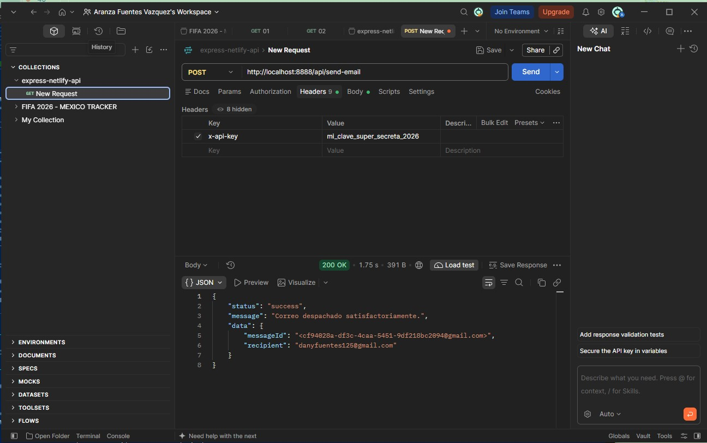
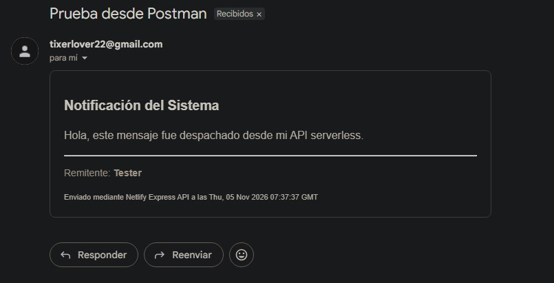
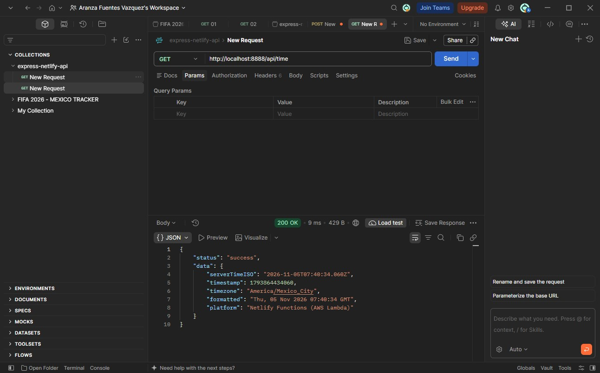
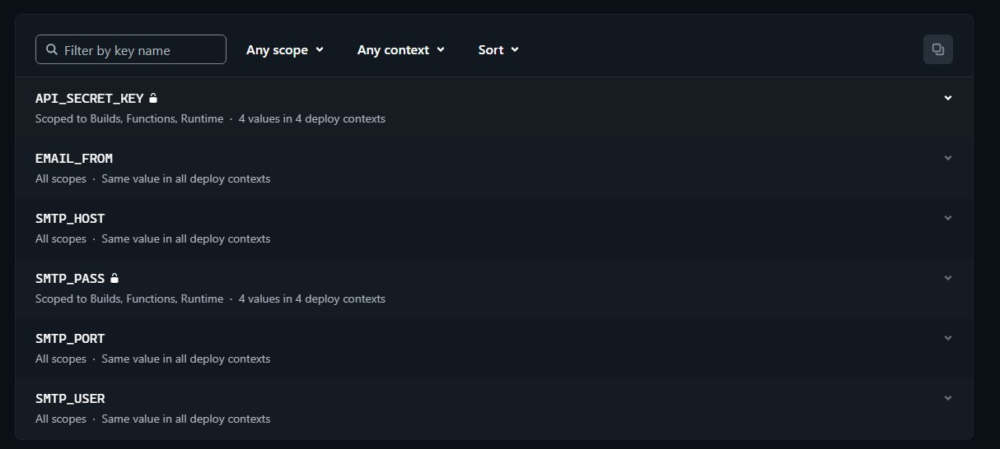

1. Cold Start en funciones serverless y Express
El Cold Start es el fenómeno que ocurre cuando una plataforma serverless (como AWS Lambda o Netlify Functions) recibe una petición después de un periodo de inactividad en el que no hay instancias activas ejecutando la función.
Para procesar la petición, la infraestructura debe realizar un proceso completo de inicialización:
-Aprovisionar un contenedor o entorno de ejecución limpio.
-Descargar el código fuente.
-Inicializar el runtime de Node.js y ejecutar el código de nivel superior (incluyendo la carga de módulos, la importación de Express, la configuración de middlewares, rutas y la conexión inicial a bases de datos).

Impacto en una API con Express: La primera petición experimenta una latencia alta (entre cientos de milisegundos y varios segundos). Una vez inicializado, el entorno permanece activo temporalmente, permitiendo que las peticiones posteriores respondan de forma inmediata. Al empaquetar una aplicación Express completa dentro de una función serverless, todo el árbol de dependencias de Express se carga durante ese arranque en frío, incrementando ligeramente el tiempo de latencia inicial en comparación con funciones serverless nativas y ultra-minimistas.

2. Estado Efímero (Statelessness) en variables globales
El uso de una variable global como let contador = 0; en el archivo de un servidor (como Node.js/Express) para contar visitas en producción es una mala práctica porque los servidores modernos son sin estado (stateless), se ejecutan en múltiples instancias independientes y se reinician constantemente.
Esto hace que el valor de la variable sea completamente inconsistente e impredecible.

Las 3 razones principales de su impredecibilidad

-1. Múltiples instancias 
En producción, para soportar miles de usuarios, tu aplicación no corre en un solo proceso. Se utilizan balanceadores de carga y herramientas como PM2, Docker o servicios Cloud (AWS, Google Cloud, Heroku) que levantan múltiples réplicas (instancias) de tu servidor.
• Cada instancia tiene su propia memoria aislada.
• Si la Instancia A atiende a un usuario, incrementará su propio contador a 1.
• Si la siguiente petición la atiende la Instancia B, leerá su propio contador, que sigue en 0, y lo subirá a 1.
• El usuario verá que el número de visitas salta de forma caótica dependiendo de qué servidor responda la petición.

-2. Reinicios y ciclo de vida efímero (Volatilidad de la Memoria)
La memoria RAM de un servidor en producción es efímera. Tu variable contador volverá a 0 cada vez que ocurra lo siguiente:
• El servidor se reinicie por una nueva implementación de código (deploy).
• El servidor se apague automáticamente por inactividad (como ocurre en plataformas Serverless como AWS Lambda o Vercel, donde el entorno se destruye tras unos minutos sin uso).
• El proceso falle y se reinicie automáticamente para recuperarse de un error.

-3. Arquitectura Serverless (Funciones Cloud)
Si tu API se despliega en un entorno Serverless, el concepto de "variable global persistente" desaparece por completo. Cada petición puede levantar un contenedor totalmente nuevo desde cero, ejecutando el script de manera limpia y destruyéndolo inmediatamente después, haciendo imposible acumular un conteo en memoria.

3. Patrón Adapter y serverless-http
Express.js no puede procesar directamente los eventos de AWS Lambda o Netlify porque fue diseñado para mantener un proceso vivo escuchando conexiones de red TCP continuas a través del módulo nativo de Node.js, mientras que las arquitecturas serverless operan mediante funciones efímeras que reciben y devuelven eventos estáticos en formato JSON. Cuando un enrutador como API Gateway invoca una función, le envía un diccionario de datos que Express simplemente no sabe interpretar, ya que su núcleo está programado para leer flujos de bytes y escribir respuestas a través de un socket de red, no para leer propiedades aisladas de un objeto.
Para resolver esta incompatibilidad de interfaces, se aplica el patrón adaptador mediante la librería 'serverless-http', cuya función exacta es actuar como un traductor bidireccional en memoria. Al recibir el evento estático de AWS o Netlify, el adaptador construye objetos simulados que imitan a la perfección la solicitud y respuesta nativas de Node.js. Posteriormente, inyecta estos objetos falsos en la aplicación de Express, engañándola para que procese la ruta como si proviniera de una conexión web tradicional.
Una vez que Express ejecuta sus middlewares y finaliza la respuesta, en lugar de intentar enviarla por la red, 'serverless-http' captura los datos del objeto simulado y los reempaqueta en la estructura JSON exacta que espera el proveedor de la nube para finalizar la ejecución. Este mecanismo permite desplegar aplicaciones de Express completas en infraestructuras orientadas a eventos sin tener que modificar el código de la lógica de negocio original.

4. Principios de 12-Factor App y Seguridad con variables de entorno
Si se sube un archivo .env con credenciales reales a un repositorio público, bots automatizados y atacantes pueden extraerlas en cuestión de segundos. Esto puede resultar en el robo de datos, uso no autorizado de servicios de pago y facturación masiva y fraudulenta en servicios cloud (como AWS o APIs de IA).
Netlify permite inyectar variables de entorno de forma segura directamente desde su panel de control o CLI. Estas variables se almacenan en el servidor de compilación y se exponen al entorno de ejecución solo cuando la aplicación corre, manteniéndose completamente ausentes del control de versiones.

5. Riesgo de Open Relay y Abuso en un Endpoint POST de Correo
Exponer un endpoint POST para envío de correos sin autenticación, sin CAPTCHA y sin límites de tasa (rate limiting) expone al servidor a consecuencias técnicas y de reputación graves:

Consecuencias técnicas:

Agotamiento de recursos (DoS): Bots maliciosos pueden saturar el servidor con millones de peticiones por segundo, colapsando la CPU, la memoria y la cuota del proveedor de correo (como SendGrid, AWS SES o SMTP propio).

Uso como Open Relay / Spam Relay: Tu servidor puede ser utilizado por actores maliciosos para enviar masivamente correos de phishing, estafas o malware a miles de víctimas inocentes utilizando tu infraestructura.

Consecuencias de reputación de dominio:

Listas negras (DNSBL / Spamhaus): Las direcciones IP y el dominio de tu servidor serán marcados rápidamente como emisores de spam.

Destrucción de la entregabilidad: Los proveedores de correo legítimos (Gmail, Outlook, Yahoo) rechazarán o enviarán a la carpeta de spam cualquier correo legítimo que intente enviar tu aplicación en el futuro, dañando severamente la operatividad del negocio.