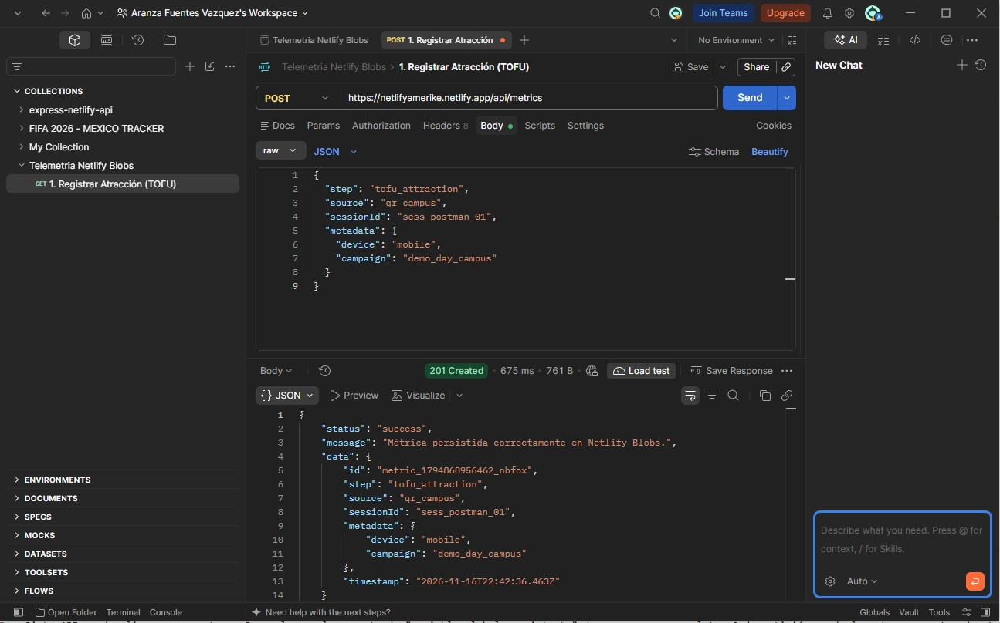
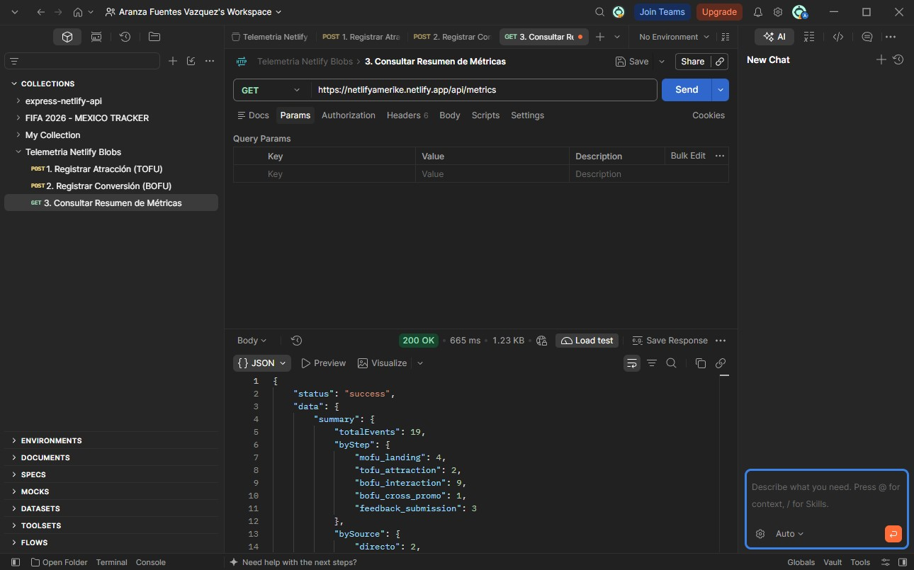
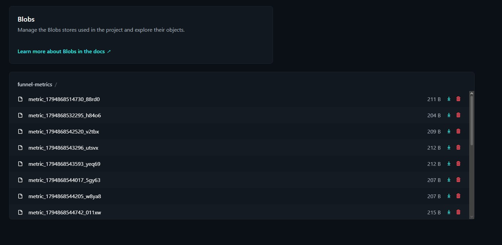

### 1. Persistencia vs. Estado Efímero 
Las funciones *serverless* (FaaS - *Function as a Service*) operan bajo un paradigma efímero y sin estado (*stateless*). Cada vez que una función es invocada, el proveedor de infraestructura aprovisiona un contenedor aislado cuya memoria volátil (RAM) existe únicamente durante el ciclo de vida activo de dicha instancia. Cuando el tráfico disminuye, el contenedor entra en un estado de hibernación o es destruido definitivamente para optimizar recursos, provocando la pérdida irrecuperable de cualquier variable global o estado almacenado en memoria.

**Netlify Blobs** soluciona esta limitación arquitectónica desacoplando por completo la capa de cómputo de la capa de persistencia. En lugar de depender del sistema de archivos local o de la memoria del contenedor, proporciona una interfaz de almacenamiento de objetos distribuido y duradero accesible mediante llamadas HTTP internas de baja latencia, garantizando que los datos sobrevivan a los reinicios, escalados horizontales y destrucciones de los contenedores de ejecución.

Asimismo, existen diferencias estructurales fundamentales entre utilizar un almacén **Clave-Valor/Objeto** frente a una **Base de Datos Relacional Tradicional (SQL)** para la captura de métricas de eventos:

* **Modelo de Datos y Flexibilidad (*Schema-less* vs. *Schema-on-Write*):** Un almacén Clave-Valor permite persistir cargas útiles JSON heterogéneas sin requerir migraciones previas, facilitando la evolución rápida de los metadatos de telemetría. Por el contrario, una base de datos SQL impone un esquema rígido, integridad referencial y normalización, lo cual introduce fricción cuando los atributos de los eventos cambian frecuentemente.
* **Gestión de Conexiones y Latencia de Arranque (*Cold Starts*):** Las bases de datos relacionales dependen de conexiones TCP persistentes y costosas en términos de memoria. En entornos *serverless* donde pueden levantarse decenas de instancias simultáneas, el agotamiento del *pool* de conexiones (*connection exhaustion*) es un fallo crítico común. Netlify Blobs opera sobre protocolos HTTP sin estado, eliminando la necesidad de mantener conexiones abiertas y reduciendo drásticamente la latencia en arranques en frío.
* **Patrones de Consulta y Escalabilidad:** Mientras que SQL destaca en consultas analíticas complejas, agregaciones multidimensionales y transacciones ACID sobre múltiples tablas, los almacenes Clave-Valor están optimizados para operaciones de lectura y escritura puntuales ($O(1)$) de altísimo rendimiento, ideales para la ingesta masiva de eventos individuales.

---

### 2. Consistencia Fuerte vs. Consistencia Eventual 
En el contexto de la computación distribuida y el teorema CAP, la **consistencia fuerte** (`consistency: 'strong'`) establece una garantía estricta mediante la cual, una vez que una operación de escritura ha sido confirmada con éxito por el sistema, cualquier operación de lectura posterior —sin importar qué nodo geográfico o réplica atienda la solicitud— devolverá obligatoriamente el valor más reciente actualizado. En contraposición, la **consistencia eventual** prioriza la máxima disponibilidad y la mínima latencia de escritura, replicando los cambios hacia los demás nodos de forma asíncrona en segundo plano; esto implica que existe una ventana de tiempo de convergencia durante la cual distintos nodos pueden servir versiones desactualizadas (*stale*) de un mismo registro.

Si se configurara nuestro panel de métricas bajo un modelo de **consistencia eventual** en un escenario de alto tráfico concurrente, se manifestarían las siguientes anomalías críticas:

* **Inconsistencias visuales y lecturas obsoletas (*Stale Reads*):** Al actualizar el *dashboard* de monitoreo, los administradores observarían fluctuaciones erráticas en los indicadores; por ejemplo, un contador podría mostrar 500 conversiones en una petición y retroceder a 492 en la siguiente recarga si el balanceador redirige la consulta a una réplica que aún no ha sincronizado los últimos eventos.
* **Pérdida de datos por condiciones de carrera (*Race Conditions*):** En patrones de actualización de tipo *Read-Modify-Write*, la falta de consistencia fuerte resulta catastrófica. Si diez peticiones concurrentes leen el valor `100` desde réplicas desactualizadas antes de que se propague la primera escritura, todas calcularán `101` y sobrescribirán el registro, provocando la pérdida silenciosa de nueve eventos legítimos.

---

### 3. Garantía de Envío en Frontend (`keepalive` y `navigator.sendBeacon`)
Cuando un usuario interactúa con un enlace saliente (*outbound link*) que redirige fuera del dominio actual —como ocurre en el flujo de redirección hacia el proyecto aliado—, el navegador web inicia inmediatamente el ciclo de descarga (*page unload*) del documento activo para liberar memoria, cancelar procesos pendientes y renderizar la nueva página de destino. Una petición asíncrona estándar ejecutada mediante `fetch()` está estrechamente acoplada al contexto de ejecución de la pestaña actual; en consecuencia, al destruirse el contexto del documento durante la navegación, el navegador aborta abruptamente la conexión TCP/HTTP en curso antes de que los paquetes de datos logren transmitirse al servidor, generando una pérdida significativa de métricas de conversión.

Para mitigar esta pérdida de telemetría existen dos mecanismos estándar en navegadores modernos:

* **La opción `keepalive: true` en `fetch()`:** Esta directiva instruye explícitamente al motor del navegador para que la petición HTTP sea desvinculada del ciclo de vida del documento actual y transferida a una cola de procesos en segundo plano gestionada a nivel de navegador. De este modo, incluso si la pestaña se cierra o navega hacia otro dominio, el navegador garantiza que la solicitud complete su transmisión.
* **La API nativa `navigator.sendBeacon()`:** Es una interfaz diseñada específicamente para el envío fiable de datos de diagnóstico y analítica al finalizar una sesión. A diferencia de `fetch()`, `sendBeacon()` encola la carga útil de forma totalmente asíncrona y no bloqueante, delegando al sistema de red del navegador la responsabilidad de transmitir los datos en el momento óptimo sin retrasar la navegación del usuario ni degradar la experiencia de transición entre páginas.

---

### 4. Particionamiento y Escalabilidad de Claves
En un escenario de alta demanda como un *Demo Day* donde el *funnel* registre 100,000 eventos individuales, la ejecución indiscriminada de `store.list()` seguida de una resolución masiva mediante `Promise.all()` en el *endpoint* `GET /api/metrics` provocaría el colapso operativo del servicio debido a múltiples cuellos de botella:

1. **Agotamiento de Memoria (OOM - *Out of Memory*) y *Timeouts*:** Recuperar y deserializar simultáneamente 100,000 objetos JSON en la memoria RAM asignada a una función *serverless* excederá la capacidad disponible, provocando la terminación forzosa del proceso. Paralelamente, la latencia acumulada superará el umbral máximo de ejecución permitido por la plataforma, resultando en errores HTTP `504 Gateway Timeout`.
2. **Saturación de I/O y Limitación de Tasa (*Throttling*):** Disparar 100,000 solicitudes de lectura concurrentes hacia la infraestructura subyacente de almacenamiento saturará los sockets de red disponibles y activará los mecanismos de protección contra abuso (*rate limits*) de la API interna de almacenamiento.

Para garantizar la escalabilidad en un entorno de producción real, se deben implementar las siguientes estrategias arquitectónicas:

* **Pre-agregación y Contadores Materializados (*Roll-ups*):** Evitar el cálculo en tiempo real sobre eventos crudos (*raw events*). En su lugar, implementar procesos asíncronos o tareas programadas (*Cron Functions*) que consoliden periódicamente los registros en claves de resumen precalculadas, permitiendo que el *dashboard* lea un único objeto ligero en milisegundos.
* **Particionamiento Jerárquico por Prefijos:** Diseñar una taxonomía de claves estructurada temporalmente. Esto permite acotar las consultas utilizando el parámetro `prefix` para recuperar exclusivamente los registros de una ventana temporal específica, evitando escanear la totalidad histórica del almacén.
* **Paginación Basada en Cursores y Procesamiento por Lotes:** Utilizar los cursores de paginación nativos del método `list()` para iterar sobre subconjuntos controlados de claves (lotes de 100 a 500 elementos) mediante procesamiento secuencial o concurrencia limitada, manteniendo el consumo de memoria constante y predecible.

---

### 5. Higiene de Datos y Prevención de Spam
Al encontrarse expuesto públicamente sin autenticación de usuario final para permitir la recolección de analíticas de visitantes anónimos, el *endpoint* `POST /api/metrics` constituye un vector de ataque vulnerable a múltiples amenazas: ataques de denegación de servicio distribuido (DDoS) destinados a agotar la cuota de invocaciones *serverless*, ataques de agotamiento de almacenamiento (*Storage Exhaustion*) mediante el envío masivo de cargas útiles gigantescas (*Payload Bombing*), e inyección de telemetría fraudulenta por parte de *bots* automatizados para distorsionar las métricas de negocio (*Data Poisoning*).

Para salvaguardar la integridad del sistema y la calidad de los datos, se deben desplegar capas defensivas complementarias:

* **Política Estricta de CORS (*Cross-Origin Resource Sharing*):** Configurar explícitamente la cabecera `Access-Control-Allow-Origin` para restringir las solicitudes provenientes del navegador únicamente al dominio oficial de producción de la *landing page*, bloqueando peticiones originadas desde sitios web maliciosos de terceros.
* **Validación Rigurosa de Esquemas (Zod / Joi):** Implementar una capa de validación estructural en la entrada del controlador antes de interactuar con el almacenamiento. Esto incluye rechazar propiedades no declaradas (`.strict()`), validar que el identificador del evento pertenezca a una lista blanca cerrada (`enum`), imponer límites estrictos de longitud a las cadenas de texto y rechazar cualquier cuerpo de petición que exceda un tamaño máximo seguro.
* **Limitación de Tasa (*Rate Limiting*) en el Borde (*Edge*):** Desplegar controles de frecuencia de peticiones por dirección IP o huella digital del cliente utilizando almacenamiento en memoria distribuida de ultra baja latencia. De este modo, el tráfico automatizado malicioso es interceptado y rechazado con un código `429 Too Many Requests` antes de consumir recursos de cómputo o escritura en la base de datos.